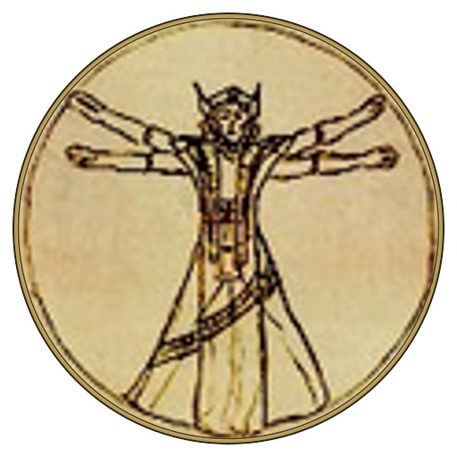

# KAGRENAC AI Mod Maker



Build an AI mod with your coding agent: choose a game, design a useful gameplay loop,
prove the game's integration, then add dialogue, voice and supported actions.

**New here? Start with the guide:**
[KAGRENAC custom mods guide](https://dwemerdynamics.com/custom-mods/index.html) ·
[Practical start: installation](https://dwemerdynamics.com/custom-mods/installation.html)

## Get started

1. Clone this repository on Windows, or use GitHub's **Use this template**.
2. Open your coding agent in the checkout and paste the prompt below.
3. Follow [the guided setup](docs/getting-started.md). The agent runs the commands and
   records progress in [PROJECT.md](PROJECT.md); you supply private credentials and test
   the result in your game.

### First prompt for your coding agent

```text
Read AGENTS.md, PROJECT.md and docs/getting-started.md. Help me build an AI mod.
Reuse what I already told you; ask only for the missing game, starting feature and mod name.
Plan a meaningful gameplay loop and qualify the game's integration before writing port code.
Prepare the server and providers alongside that research. Use in-game text chat by default;
add voice if requested and speech input only if requested. Run the setup, implement, test,
review the actual changes, and fix findings. Keep keys out of chat and preserve existing work.
```

## Requirements

- Windows with Git and a coding agent of your choice. No separate coding model is required.
- [DwemerDistro](https://dwemerdynamics.com/custom-mods/installation.html#InstallDistro) for the local PHP 8.2 and
  PostgreSQL server, with a **compatible Core** (see below). If it is missing, your agent
  can help you install it, but downloads nothing unless you ask; you can keep planning
  meanwhile ([details](docs/getting-started.md#before-you-start)).
- The game's own mod tools or a qualified loader for its exact build. C++ ports and the
  console example need Visual Studio C++ tools; script or managed ports use their own tools.
- An LLM provider for real conversations. Recommended defaults are OpenRouter Gemma for
  dialogue, JEV for supported bounded decisions, and PocketTTS for requested voice.
  [Provider settings](CONNECTORS.md) give the exact model IDs and alternatives.

**Run Update Distro before your first deployment**, including after a fresh base-image
install. It fetches Core's current `main` with the helpers guided setup needs; the older
**v1.0.8 tag** and some base images lack them. The version label alone is not a
compatibility test: check the helper after updating. Deploy refuses an incompatible Core
before installing source; do not bypass that guard. The required helper switches, checks
and manual route are in [setup compatibility](docs/getting-started.md#before-you-start).

## What is included, and what each game needs

Every mod copied from this template starts from the same server source and shared client library,
then gets its own source repository, server, database and private pairing. The
game-side work (native input and UI, reading game state, playing voice, running actions,
loading through the game's mod loader) is built and verified for the game you choose.

| Component | Included | Evidence boundary |
|---|---|---|
| Server | Turns, game events, NPC bios and knowledge, history, checkpoints, optional memory, dashboard and provider connectors | Mock-mode checks are repeatable; real providers need their own test |
| Shared C++ client | Async turns, cancellation, action handlers, text before voice, engine-free text-composer lifecycle | Builds for x64 and x86; the console simulates a game |
| Voice | PocketTTS and supported alternatives; optional transcription | Off by default. The console saves WAVs; each game port must implement playback and requested microphone input |
| Engine ports | A process for planning and qualifying a game integration, plus a data-only build-record contract | No game port ships with this template; each mod builds and verifies its own |
| Install and pairing | Committed-source deploy, named server roots and private client config | Requires compatible Core; installing the server alone does not install a game plugin |

The model can request allowlisted actions. Both server and client validate them; the game
must provide a real handler and observe its outcome. A returned action is not proof it ran.
JEV's shipped `decision.php` contract selects an answering NPC from the candidates offered
by the game. Other decision systems need a planned, validated game-specific contract.

## How a mod is built

**Brief → gameplay design → game integration proof → first connected prototype → expansion.**

The first prototype should show the requested loop in game, with current game context,
a visible recipient, free typed chat, a reply and any requested voice or qualified action.
Automatic remarks must respond to meaningful observed events, yield to player input and
end cleanly. A probe, mocked conversation or external chat window is not that prototype.

After one-time installation and pairing, the mod loads and connects through the game's
normal mod loader. The player starts DwemerDistro and the game; no per-session transport
or provider-arming command. See [installed startup acceptance](docs/ENGINE_PLANNING.md#installed-startup-acceptance).

## Directory map

The repository root is the server; everything else sits beside it in one repository.

| Path | Purpose |
|---|---|
| `*.php` (root) | Server endpoints, one small file each (`turn.php`, `event.php`, `decision.php`, ...) |
| `lib/`, `sql/` | Server services and helpers; numbered database migrations |
| `config/` | `config.example.php`; your private `config/config.php` is untracked |
| `ui/` | Dashboard pages, styles and branding images |
| `client/` | Shared C++ client library and console example; [client guide](client/README.md), [client rules](client/AGENTS.md) |
| `ports/` | Your mod's game-specific source, build route and evidence in `ports/<engine>/`; see [ports/README.md](ports/README.md) |
| `scripts/` | Setup, deployment, pairing, migrations, backup, smoke checks and content import; start with `scripts\project.ps1` |
| `docs/` | Authoring guides: [guided setup](docs/getting-started.md), gameplay design, engine planning, recipes, engine evidence and research |
| `AGENTS.md`, `PROJECT.md` | Rules for your coding agent; your mod's one brief, plan, status and evidence record |
| Other root `*.md` | References listed below (setup, providers, protocol, dashboard, security) |
| `dwemer-mod.json` | Server identity; generated projects get their own id and `<Name>Server` folder |

## References

| Need | Read |
|---|---|
| Start or resume a mod | [Guided setup](docs/getting-started.md), [PROJECT.md](PROJECT.md) |
| Design the experience | [Gameplay design](docs/GAMEPLAY_DESIGN.md), [engine planning](docs/ENGINE_PLANNING.md) |
| Find a reference or diagnose a request | [START_HERE.md](START_HERE.md) |
| Install, pair, update or remove | [SETUP.md](SETUP.md), [legacy launcher branch route](LAUNCHER_CUSTOM_MOD.md) |
| Configure models and voice | [CONNECTORS.md](CONNECTORS.md) |
| Use or extend the dashboard | [UI_GUIDE.md](UI_GUIDE.md) |
| Implement the protocol | [PROTOCOL.md](PROTOCOL.md), [client guide](client/README.md), [architecture](docs/ARCHITECTURE.md) |
| Extend a port | [Agent playbook](docs/agent-playbook.md), [port recipes](docs/feature-recipes/PORT_RECIPES.md), [engine evidence record](docs/engine-packs/ENGINE_PACK.md) |
| Add NPC bios and world knowledge in bulk | [Content authoring](docs/CONTENT_AUTHORING.md) |
| Rebrand your mod | [MAKE_IT_YOURS.md](MAKE_IT_YOURS.md) |
| Share a finished mod | [Community publishing](docs/PUBLISHING.md) |
| Contribute or report a problem | [CONTRIBUTING.md](CONTRIBUTING.md), [SECURITY.md](SECURITY.md) |
